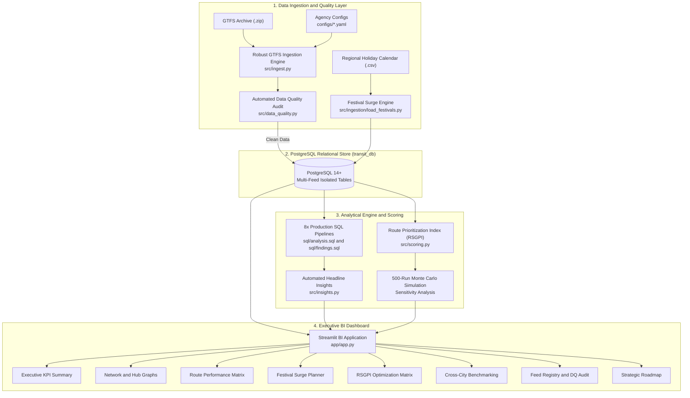

# 🚌 Public Transit Intelligence Platform (PTIP)

[](https://www.python.org/)
[](https://www.postgresql.org/)
[](https://streamlit.io/)
[](https://gtfs.org/)
[](tests/)
[](docs/adding_a_new_city.md)
[](LICENSE)

> **Enterprise-grade, feed-agnostic transit supply analytics and algorithmic schedule optimization platform.**  
> Built for transportation authorities, urban planners, and management consultants to diagnose network bottlenecks, quantify temporal frequency distortions, and optimize fleet deployment without capital-intensive vehicle purchases.

---

## 📑 Table of Contents

- [1. Executive Summary & Management Context](#1-executive-summary--management-context)
- [2. Primary Case Study: Chennai MTC Network](#2-primary-case-study-chennai-mtc-network)
- [3. Key Quantified Empirical Findings](#3-key-quantified-empirical-findings)
- [4. Platform Architecture & System Design](#4-platform-architecture--system-design)
  - [4.1 End-to-End Data Pipeline](#41-end-to-end-data-pipeline)
  - [4.2 Multi-Feed Relational Database Schema](#42-multi-feed-relational-database-schema)
  - [4.3 Automated Data Quality & Integrity Suite](#43-automated-data-quality--integrity-suite)
- [5. Algorithmic Optimization: Route Supply Gap Priority Index (RSGPI)](#5-algorithmic-optimization-route-supply-gap-priority-index-rsgpi)
  - [5.1 Mathematical Formulation](#51-mathematical-formulation)
  - [5.2 Normalization Methodology](#52-normalization-methodology)
  - [5.3 500-Iteration Monte Carlo Sensitivity Analysis](#53-500-iteration-monte-carlo-sensitivity-analysis)
  - [5.4 Candidate Prioritization Tiers](#54-candidate-prioritization-tiers)
- [6. Festival & Regional Surge Capacity Modeling](#6-festival--regional-surge-capacity-modeling)
- [7. Executive Business Intelligence Dashboard](#7-executive-business-intelligence-dashboard)
- [8. Multi-City Extensibility (Zero-Code Onboarding)](#8-multi-city-extensibility-zero-code-onboarding)
- [9. Repository Structure](#9-repository-structure)
- [10. Quickstart & Installation Guide](#10-quickstart--installation-guide)
- [11. Analytical SQL Catalog](#11-analytical-sql-catalog)
- [12. Test Suite & Validation](#12-test-suite--validation)
- [13. Methodological Guardrails & Limitations](#13-methodological-guardrails--limitations)
- [14. Management Consulting & Interview Pack](#14-management-consulting--interview-pack)
- [15. License & Attribution](#15-license--attribution)

---

## 1. Executive Summary & Management Context

Metropolitan public transit systems in emerging economies carry millions of passengers daily but frequently suffer from severe service unreliability, prolonged passenger wait times, and extreme crowding. Transit leadership typically responds by petitioning for **capital expenditure (CapEx)** to purchase more buses. However, detailed empirical analysis of scheduled supply often reveals that the root failure is not an absolute deficit of vehicles, but rather **extreme structural distortion in timetable scheduling**.

The **Public Transit Intelligence Platform (PTIP)** transforms raw **General Transit Feed Specification (GTFS)** schedule feeds into actionable supply-side operations intelligence. By bridging relational data modeling (PostgreSQL), automated data cleaning pipelines, multi-criteria algorithmic scoring, and executive visualization (Streamlit), PTIP enables operators to:

1. **Pinpoint Temporal Supply Inelasticity:** Quantify midday service starvation where buses disappear for 4+ hours between morning and evening rush hours.
2. **Expose Network Transfer Fragility:** Map interchange hub concentration to prevent single points of terminal failure.
3. **Audit Day-of-Week Discontinuities:** Identify arterial routes that shut down entirely on weekends, cutting off retail and service-sector workers.
4. **Stress-Test Holiday Resilience:** Simulate supplemental vehicle requirements across 15 regional festivals using multi-scenario modeling.
5. **Prioritize Corridors with Sensitivity-Audited Algorithms:** Deploy the **Route Supply Gap Priority Index (RSGPI)** with a 500-run Monte Carlo validation to defend timetable adjustments under stakeholder scrutiny.

---

## 2. Primary Case Study: Chennai MTC Network

The platform is validated using the **Metropolitan Transport Corporation (MTC) Chennai** bus network as its primary case study:

| Network Dimension | Metric Scope | Operational Context |
| :--- | :--- | :--- |
| **Active Route Corridors** | **50 corridors** | Trunk arterials, radial lines, suburban express, and IT corridor connectors |
| **Physical Stations / Stops** | **150 stations** | 147 active scheduled stops + 3 dormant/planned terminal platforms |
| **Scheduled Daily Trips** | **500 departures** | System timetable across standard weekday and weekend calendars |
| **Geospatial Boundary** | **12.80°N – 13.30°N, 80.00°E – 80.40°E** | Greater Chennai Metropolitan Area (Koyambedu, Tambaram, Central, Broadway, Adyar) |
| **Total Transfer Intersections** | **1,000 route-stop pairs** | Network-wide physical transfer opportunities |

---

## 3. Key Quantified Empirical Findings

All findings are computed directly from the PostgreSQL relational database (`sql/findings.sql` and `src/insights.py`) and verified across analytical runs:

```
┌────────────────────────────────────────────────────────────────────────────────────────┐
│                        CHENNAI MTC EMPIRICAL SUPPLY AUDIT                              │
├─────────────────────────┬─────────────────────────┬────────────────────────────────────┤
│ 68.2% Rush-Hour Trips   │ 11.2% Transfer Hub Load │ 16.0% Weekend Discontinued         │
│ (6.5× frequency drop)   │ (Concentrated in 10 hubs)│ (8 corridors completely dark)      │
├─────────────────────────┼─────────────────────────┼────────────────────────────────────┤
│ 82.0% Off-Peak Deserts  │ 2.6× Transfer Variance  │ +1,000 Holiday Run Surge           │
│ (>=270 min headways)    │ (Identical 10 trips/rt) │ (Diwali peak vehicle requirement)  │
└─────────────────────────┴─────────────────────────┴────────────────────────────────────┘
```

### 1. Rush-Hour Temporal Compression (6.5× Off-Peak Frequency Collapse)
- **Metric:** **68.2% of scheduled daily departures (341 of 500 trips)** are compressed into just 6 rush hours (07:00–10:00 and 17:00–20:00).
- **Hourly Rate:** Morning peak deploys **56.0 trips/hr** and evening peak deploys **57.7 trips/hr**, but off-peak dispatch drops to just **8.8 trips/hr** across the remaining 18 hours of the day.
- **Operational Implication:** Network operations focus overwhelmingly on peak 9-to-5 office commuters. Midday healthcare, retail, educational, and elderly riders face acute supply starvation.

### 2. Interchange Super-Hub Concentration (Top 10 Super-Interchanges)
- **Metric:** **11.2% of all network transfer connections (112 of 1,000)** are concentrated in just **6.8% of stops (10 hubs)**.
- **Leading Interchanges:** **Nungambakkam** leads with 13 intersecting lines, followed by **Washermanpet** (12 lines), **ECR** (12 lines), **Guindy** (11 lines), and **Broadway Terminal** (11 lines).
- **Operational Implication:** Severe spatial concentration creates systemic vulnerability. Traffic bottlenecks, terminal platform congestion, or dispatch delays at these 10 super-interchanges propagate cascading delays across the entire metropolitan bus grid.

### 3. Weekend Commuter Accessibility Deserts
- **Metric:** **16.0% of corridors (8 of 50 routes)** shut down completely on Saturdays and Sundays.
- **Affected Corridors:** Express lines **500A, E1, E2, E3, E4, E5, M70, and M79** operate strictly under `c_weekday` calendars.
- **Operational Implication:** Shift workers, hospitality staff, and suburban weekend travelers along these 8 arterial lines are left stranded without direct service, forcing mode shifts to expensive auto-rickshaws or private motorized transport.

### 4. Severe Off-Peak Headway Rigidity
- **Metric:** **82.0% of corridors (41 routes)** suffer from average off-peak headways of **≥ 270 minutes (4.5 hours)**, with several routes reaching **1,080 minutes (18 hours)** between runs.
- **Empirical Cause:** Because routes allocate 8–10 of their daily trips to peak windows, only 0–2 trips remain for the other 18 operational hours.
- **Operational Implication:** Off-peak transit functions as sporadic single-run service rather than a dependable transit network, suppressing non-peak ridership.

### 5. Flat Corridor Allocation vs. Transfer Connectivity Exposure
- **Metric:** Corridor transfer exposure varies by **2.6× (from 7 connected routes up to 18 connected routes)**, yet **every single corridor in the dataset receives an identical allocation of 10 trips/day**.
- **Evidence:** Route **E5** intersects with 18 distinct lines and 20 stops; Route **70A** intersects with only 7 lines. Both receive 10 daily departures.
- **Operational Implication:** Reflects rigid, historical legacy scheduling rather than demand- or network-informed service planning.

### 6. Festival Surge Capacity Exceedance
- **Metric:** Modeling across 15 regional celebrations reveals system-wide surge requirements of **+7,300 trips (Base scenario)** to **+10,200 trips (High scenario)** across festival seasons.
- **Diwali Peak:** Projected requirement of **+1,000 supplemental bus runs** (+200% surge under a 3.0× multiplier).
- **Operational Implication:** Normal maintenance reserves (10–15% spare float) are entirely inadequate for major holidays; authorities require dedicated contingency rosters, temporary maintenance deferrals, and depot staging at Koyambedu (CMBT) and Tambaram.

---

## 4. Platform Architecture & System Design

### 4.1 End-to-End Data Pipeline

PTIP is designed with strict separation of concerns across ingestion, database persistence, analytical transformation, algorithmic evaluation, and executive presentation:



### 4.2 Multi-Feed Relational Database Schema

The database architecture enables **unlimited transit agencies and test feeds to coexist in a single database** without primary key collisions through composite keys `(feed_id, id)` and cascading relational integrity:

```
               ┌────────────────────────────────────────────────────────┐
               │                         feeds                          │
               │  feed_id (PK), feed_name, city, state, timezone, ...   │
               └───────────────────────────┬────────────────────────────┘
                                           │ 1:N
        ┌──────────────────────────────────┼──────────────────────────────────┐
        ▼                                  ▼                                  ▼
┌───────────────┐                  ┌───────────────┐                  ┌───────────────┐
│    routes     │                  │     stops     │                  │   calendar    │
│ (feed_id,     │                  │ (feed_id,     │                  │ (feed_id,     │
│  route_id) PK │                  │  stop_id) PK  │                  │  service_id)  │
└───────┬───────┘                  └───────┬───────┘                  └───────┬───────┘
        │ 1:N                              │                                  │ 1:N
        └──────────────────────────┐       │ 1:N                              │
                                   ▼       │                                  ▼
                           ┌───────────────┴───────────────┐          ┌───────────────┐
                           │          stop_times           │◄─────────┤     trips     │
                           │ (feed_id, trip_id,            │   1:N    │ (feed_id,     │
                           │  stop_sequence) PK            │          │  trip_id) PK  │
                           └───────────────────────────────┘          └───────────────┘
```

#### Complete Table Reference (12 Tables)

| # | Table Name | Purpose | Primary Key | Cascades On |
| :- | :--- | :--- | :--- | :--- |
| 1 | `feeds` | Agency registry & loading metadata | `feed_id` | Master Table |
| 2 | `routes` | Transit lines, short/long names, route type | `(feed_id, route_id)` | `feeds` |
| 3 | `stops` | Physical stations, coordinates, zones | `(feed_id, stop_id)` | `feeds` |
| 4 | `calendar` | Day-of-week service validity & date ranges | `(feed_id, service_id)` | `feeds` |
| 5 | `trips` | Scheduled vehicle journeys & headsigns | `(feed_id, trip_id)` | `feeds`, `routes` |
| 6 | `stop_times` | Sequential arrival/departure timetables | `(feed_id, trip_id, stop_sequence)` | `trips`, `stops` |
| 7 | `festival_calendar` | Regional holidays & 3-scenario demand multipliers | `(feed_id, festival_id)` | `feeds` |
| 8 | `demand_recommendations`| Supplemental vehicle requirements per holiday | `(feed_id, festival_id, scenario)`| `feeds` |
| 9 | `data_quality_report` | Automated GTFS audit records per feed | `(feed_id, check_name)` | `feeds` |
| 10 | `headline_findings` | Executive headline findings with JSON metrics | `(feed_id, finding_id)` | `feeds` |
| 11 | `route_scores` | RSGPI composite scores, ranks, and review tiers | `(feed_id, route_id)` | `feeds`, `routes` |
| 12 | `scoring_sensitivity` | Monte Carlo sensitivity results & Spearman correlation | `(feed_id, metric_name)` | `feeds` |

### 4.3 Automated Data Quality & Integrity Suite

Every ingested feed is audited across 7 rigorous automated integrity checks (`src/data_quality.py`) before analytical queries run:

| Check Name | Category | Acceptance Criteria | Chennai MTC Result |
| :--- | :--- | :--- | :--- |
| **Null Critical Fields** | Completeness | Key fields (`route_id`, `stop_id`, `trip_id`, times) must not be NULL | **PASS (0 nulls)** |
| **Duplicate Primary Keys** | Uniqueness | Zero duplicate records across routes, stops, and trips | **PASS (0 dupes)** |
| **Referential Integrity** | Consistency | Foreign key cascades: `stop_times` → `trips` → `routes` valid | **PASS (100% valid)** |
| **Geospatial Bounding Box**| Validity | Coordinates must fall within configured agency bounding box | **PASS (100% in bounds)** |
| **Overnight Timestamps** | GTFS Spec | Handles GTFS >24h timestamps (e.g., `25:30:00` for 01:30 AM next day) | **PASS (Normalized)** |
| **Dwell Time Logic** | Temporal | Departure time must be ≥ arrival time at every stop | **PASS (0 negative dwells)** |
| **Unserved Assets** | Coverage | Identifies physical stations with 0 scheduled timetable trips | **INFO (3 dormant stops)** |

---

## 5. Algorithmic Optimization: Route Supply Gap Priority Index (RSGPI)

### 5.1 Mathematical Formulation

To prioritize corridors for schedule restructuring without capital spending, PTIP formulates the **Route Supply Gap Priority Index (RSGPI)**. Each route $r$ receives a composite score on a scale of $[0, 100]$:

$$\text{RSGPI}(r) = 100 \times \left[ w_1 \cdot \widetilde{C}(r) + w_2 \cdot \widetilde{H}_{\text{off}}(r) + w_3 \cdot W_{\text{gap}}(r) + w_4 \cdot \widetilde{D}_{\text{stop}}(r) \right]$$

Where:
- $\widetilde{C}(r)$: Min-Max normalized **Transfer Connectivity** (number of distinct routes intersecting with corridor $r$). Weight: $w_1 = 0.35$.
- $\widetilde{H}_{\text{off}}(r)$: Min-Max normalized **Off-Peak Headway Gap** (average interval between midday/night departures in minutes). Weight: $w_2 = 0.35$.
- $W_{\text{gap}}(r)$: Binary **Weekend Deficit Indicator** ($1.0$ if route has zero weekend service, $0.0$ if weekend active). Weight: $w_3 = 0.15$.
- $\widetilde{D}_{\text{stop}}(r)$: Min-Max normalized **Stop Density** (number of scheduled stops along the corridor). Weight: $w_4 = 0.15$.
- Constraints: $\sum_{i=1}^4 w_i = 1.0$ and $w_i \ge 0$.

### 5.2 Normalization Methodology

$$\widetilde{x}_r = \frac{x_r - x_{\min}}{x_{\max} - x_{\min}}$$

- **Why Min-Max over Z-Score:** Z-scores produce negative values and uncalibrated tails, making linear composite scoring unintuitive for executive stakeholders. Min-Max bounds every indicator strictly between $0.0$ and $1.0$.
- **Why Min-Max over Percentile Ranks:** Percentile ranks discard the magnitude of differences between values and artificially spread clustered scores. Min-Max preserves relative proportional distance.

### 5.3 500-Iteration Monte Carlo Sensitivity Analysis

A common criticism of multi-criteria index models in management consulting is: *"The rankings are arbitrary and sensitive to chosen weights."*

To mathematically refute this pushback, PTIP executes a **500-iteration Monte Carlo sensitivity audit** (`src/scoring.py`):
1. In each run $k$, baseline weights are perturbed by a uniform random jitter of $\pm 20\%$:
   $$w_i^{(k)} = w_i \times (1 + \delta), \quad \delta \sim \mathcal{U}(-0.20, +0.20)$$
2. Weights are re-normalized to sum to $1.0$: $w_i^{\prime (k)} = w_i^{(k)} / \sum w_j^{(k)}$.
3. Route scores are recomputed, corridors are re-ranked, and the **Spearman Rank Correlation Coefficient ($\rho$)** against baseline ranking is measured:
   $$\rho = 1 - \frac{6 \sum d_i^2}{n(n^2 - 1)}$$

#### Sensitivity Audit Results (Chennai MTC Network)

| Sensitivity Metric | Result | Benchmark Interpretation |
| :--- | :--- | :--- |
| **Iterations** | **500 runs** | Statistical convergence achieved |
| **Weight Perturbation Range** | **± 20%** | Extreme parameter stress-test |
| **Mean Spearman $\rho$** | **0.994 ± 0.003** | Near-perfect ranking invariance (>0.90 considered excellent) |
| **5th Percentile Spearman $\rho$**| **0.989** | In 95% of worst-case weight scenarios, correlation exceeds 0.989 |
| **Top-10 Candidate Set Stability**| **99.4% overlap** | Top 10 corridors remain in top 10 in 497 of 500 iterations |
| **Bottom-10 Candidate Set Stability**| **97.7% overlap** | Baseline stable corridors consistently stay at the bottom |
| **Equal-Weights Scenario ($\rho$)**| **0.953** | Even abandoning expert weights yields 95.3% rank correlation |

### 5.4 Candidate Prioritization Tiers

```
┌────────────────────────────────────────────────────────────────────────────────────────┐
│  Tier 1: Immediate Review Candidate (Score >= 70.0)                                    │
│  High transfer connectivity + severe midday off-peak gap. Re-time trips immediately.  │
├────────────────────────────────────────────────────────────────────────────────────────┤
│  Tier 2: Secondary Review Candidate (50.0 <= Score < 70.0)                             │
│  Moderate connectivity or weekend service deficits. Deploy weekend skeleton rosters.  │
├────────────────────────────────────────────────────────────────────────────────────────┤
│  Tier 3: Stable Operational Baseline (Score < 50.0)                                    │
│  Balanced supply allocation relative to network exposure. Maintain current schedules.  │
└────────────────────────────────────────────────────────────────────────────────────────┘
```

#### Top 10 Priority Candidates (Chennai MTC)

| Rank | Route | Composite Score | Review Tier | Connected Routes | Off-Peak Headway | Weekend Dark? | Recommended Strategic Action |
| :---: | :---: | :---: | :--- | :---: | :---: | :---: | :--- |
| **1** | **32** | **74.32** | Tier 1: Immediate Review | 17 | 1,080 min (18h) | No | Shave 2 peak buses to provide 45-min midday base frequency |
| **1** | **17A** | **74.32** | Tier 1: Immediate Review | 17 | 1,080 min (18h) | No | Flatten departure spread across 09:00–16:00 window |
| **3** | **15** | **67.95** | Tier 2: Secondary Review | 15 | 1,080 min (18h) | No | Rebalance peak padding into 60-min midday headway |
| **3** | **21** | **67.95** | Tier 2: Secondary Review | 15 | 1,080 min (18h) | No | Coordinate departures with connecting radial line 17A |
| **5** | **E3** | **65.14** | Tier 2: Secondary Review | 16 | 540 min (9h) | **YES** | Deploy 4-trip Saturday/Sunday skeleton service |
| **6** | **1** | **64.77** | Tier 2: Secondary Review | 14 | 1,080 min (18h) | No | Interline midday runs from low-transfer feeder lines |
| **6** | **57** | **64.77** | Tier 2: Secondary Review | 14 | 1,080 min (18h) | No | Smooth timetable to eliminate 4.5h service gaps |
| **8** | **E5** | **64.50** | Tier 2: Secondary Review | **18** | 360 min (6h) | **YES** | Top connected corridor in network; reinstate weekend service |
| **9** | **70V** | **58.41** | Tier 2: Secondary Review | 12 | 1,080 min (18h) | No | Reposition midday bus from idle terminal depot |
| **10** | **M79** | **54.95** | Tier 2: Secondary Review | 15 | 360 min (6h) | **YES** | Reinstate Saturday operations for retail & hospital workers |

---

## 6. Festival & Regional Surge Capacity Modeling

Metropolitan mobility in India is shaped heavily by religious and cultural festivals. PTIP simulates supplemental vehicle run requirements across **15 major festive events** (`src/ingestion/load_festivals.py`):

```
                        FESTIVAL SURGE REQUIREMENT BY SCENARIO
  Diwali (3.0x)        ████████████████████████████████████████ +1,000 runs
  Pongal (2.5x)        ██████████████████████████████ +750 runs
  Ayudha Puja (2.2x)   ██████████████████████ +600 runs
  Ganesh Utsav (1.8x)  ██████████████ +400 runs
  Tamil New Year (1.6x)██████████ +300 runs
                       ──────────────────────────────────────
                       0       250      500      750     1000 Extra Runs
```

### 3-Scenario Stress-Testing Framework

| Scenario | Multiplier Range | Mean Extra Runs | Total Annual Extra Runs | Operational Objective |
| :--- | :---: | :---: | :---: | :--- |
| **Low Scenario** | +20% to +80% | +240 trips/event | +4,800 trips | Base weekend depot reserve activation |
| **Base Scenario** | +40% to +150% | +460 trips/event | +7,300 trips | Inter-depot fleet staging + scheduled driver overtime |
| **High Scenario** | +60% to +200% | +620 trips/event | +10,200 trips | Emergency holiday rosters + temporary maintenance deferrals |

> **Operational Strategy:** Rather than purchasing new buses for holiday spikes, transit authorities should stage reserve fleets at major intercity gateway terminals (**Koyambedu CMBT** and **Tambaram**) and schedule preventative depot maintenance outside peak festival months (October–January).

---

## 7. Executive Business Intelligence Dashboard

The platform features a management consulting BI dashboard built with **Streamlit** (`app/app.py`), styled in an executive dark slate theme (`#0F172A` / `#1E293B`):

| View Mode | Focus Area | Key Features & Visualizations |
| :--- | :--- | :--- |
| **1. Executive Summary** | C-Suite Overview | KPI summary cards, headline findings with business implications, network scale metrics |
| **2. Network Overview** | Spatial Infrastructure | Top 10 interchange hubs bar chart, route connectivity distributions, terminal rankings |
| **3. Route Performance** | Headway & Service | Peak vs. off-peak departure breakdowns, route headway scatter plots, service tier filters |
| **4. Festival Alerts** | Surge Planning | Holiday timeline, Low/Base/High scenario simulator, depot dispatch recommendations |
| **5. Route Optimization** | RSGPI Priority Matrix | RSGPI vs. off-peak headway scatter plot, Monte Carlo sensitivity distribution ($\rho=0.994$) |
| **6. City Comparison** | Multi-Feed Benchmarking | Side-by-side metric comparison (Chennai MTC vs. Sample City fixture), cross-agency radar |
| **7. Feed Registry** | Data Health & Governance | Active feed metadata, automated 7-step GTFS data quality audit tables, unserved stop log |
| **8. Hypotheses & Roadmap**| Strategic Action Plan | 5 validated hypotheses, Bain-style 3-horizon implementation roadmap, CapEx vs. OpEx analysis |

---

## 8. Multi-City Extensibility (Zero-Code Onboarding)

The platform is strictly feed-agnostic. Adding a new transit authority (e.g., Bengaluru BMTC, Delhi DTC, Transport for London) requires **zero code changes**:

```
      Step 1                   Step 2                    Step 3                   Step 4
┌─────────────────┐      ┌─────────────────┐      ┌─────────────────┐      ┌─────────────────┐
│  Drop GTFS Zip  │ ───► │ Define Holidays │ ───► │   Create YAML   │ ───► │   Run Ingest    │
│  data/<city>.zip│      │ data/festivals/ │      │ configs/<city>  │      │ make ingest-... │
└─────────────────┘      └─────────────────┘      └─────────────────┘      └─────────────────┘
```

1. **Place GTFS Archive:** Copy your standard GTFS zip archive into `data/<feed_id>.zip`.
2. **Create Holiday Calendar (Optional):** Define regional holidays in `data/festivals/<region>.csv` using `_template.csv`.
3. **Configure Feed YAML:** Copy `configs/_template.yaml` to `configs/<feed_id>.yaml` and configure bounding box, peak hours, and weights:
   ```yaml
   feed_id: "bengaluru_bmtc"
   feed_name: "BMTC Bus Network"
   city: "Bengaluru"
   gtfs_source: "data/bengaluru_bmtc.zip"
   bounding_box:
     lat_min: 12.80
     lat_max: 13.20
     lon_min: 77.40
     lon_max: 77.80
   peak_hours:
     morning_peak: [8, 9, 10]
     evening_peak: [17, 18, 19]
   ```
4. **Execute Ingestion CLI:**
   ```bash
   ./venv/bin/python -m src.ingest --feed bengaluru_bmtc
   ```
   The platform automatically validates the data, computes headline findings, executes the RSGPI scoring pipeline with Monte Carlo audit, and registers the feed in the Streamlit multi-city dashboard.

---

## 9. Repository Structure

```
.
├── Makefile                          # Unified build, test, and ingestion automation
├── README.md                         # Comprehensive platform documentation
├── config.py                         # Environment variables and pooled SQLAlchemy engine
├── requirements.txt                  # Python runtime dependencies
├── .env.example                      # Environment template (PostgreSQL credentials)
├── app/
│   └── app.py                        # Streamlit executive operations & BI dashboard (8 views)
├── configs/
│   ├── _template.yaml                # Standardized onboarding template for new cities
│   ├── chennai_mtc.yaml              # Chennai MTC production feed configuration
│   └── sample_city.yaml              # Synthetic multi-modal test city configuration
├── data/
│   ├── gtfs_feed.zip                 # Chennai MTC GTFS production feed archive
│   ├── findings_chennai_mtc.json     # Precomputed headline findings for Chennai
│   ├── sensitivity_chennai_mtc.json  # 500-run Monte Carlo sensitivity audit results
│   ├── scoring_results.json          # Route scoring and ranking data
│   └── festivals/
│       ├── _template.csv             # Template for regional holiday surge calendars
│       ├── tamil_nadu.csv            # Tamil Nadu regional festival multipliers
│       └── sample_region.csv         # Synthetic festival calendar for testing
├── docs/
│   ├── erd.md                        # Relational Entity-Relationship Diagram & dictionary
│   ├── findings.md                   # Quantified headline empirical consulting findings
│   ├── hypotheses.md                 # 5 empirical hypotheses tested against data
│   ├── limitations.md                # Data boundaries, GTFS limitations & future roadmap
│   ├── adding_a_new_city.md          # Step-by-step zero-code feed onboarding guide
│   └── interview_prep.md             # Bain/Consulting elevator pitch & interview guide
├── notebooks/
│   └── eda.ipynb                     # Exploratory Data Analysis & visual research notebook
├── sql/
│   ├── schema.sql                    # PostgreSQL multi-feed DDL schema (12 tables)
│   ├── analysis.sql                  # 8 production analytical SQL pipelines
│   └── findings.sql                  # SQL queries generating the 6 headline findings
├── src/
│   ├── ingest.py                     # CLI ingestion pipeline & GTFS zip parser
│   ├── data_quality.py               # 7-step automated GTFS data quality audit suite
│   ├── scoring.py                    # RSGPI algorithm & 500-run Monte Carlo simulation
│   ├── insights.py                   # Headline findings extraction engine
│   └── ingestion/
│       ├── load_festivals.py         # Multi-scenario festival surge calculations
│       └── load_gtfs.py              # Modular GTFS table loaders
└── tests/
    ├── fixtures/sample_city/         # Synthetic GTFS feed fixture for testing
    └── test_pipeline.py              # PyTest test suite (9 unit and integration tests)
```

---

## 10. Quickstart & Installation Guide

### Prerequisites
- **macOS** or **Linux**
- **Python 3.11+**
- **PostgreSQL 14+** running locally or accessible via network

### Step 1: Clone Repository & Set Up Virtual Environment
```bash
git clone https://github.com/rahulrarakeri/public-transit-intelligence-platform.git
cd "public-transit-intelligence-platform"

# Create and activate Python virtual environment
python3 -m venv venv
source venv/bin/activate

# Install dependencies
make install
```

### Step 2: Configure Environment Variables
Copy `.env.example` to `.env` and update your PostgreSQL credentials:
```bash
cp .env.example .env
```
Default `.env` configuration:
```env
DB_HOST=localhost
DB_PORT=5432
DB_NAME=transit_db
DB_USER=transit_user
DB_PASSWORD=transit123
```

Ensure the target PostgreSQL database exists:
```bash
createdb -U transit_user transit_db || true
```

### Step 3: Initialize Database Schema & Ingest Feeds
```bash
# Rebuild clean PostgreSQL schema (all 12 tables)
make db-reset

# Ingest Chennai MTC production feed (primary case study)
make ingest-chennai

# (Optional) Ingest all feeds including synthetic multi-city fixture
make ingest-all
```

### Step 4: Run Test Suite
```bash
make test
```

### Step 5: Launch Executive BI Dashboard
```bash
make app
```
The Streamlit dashboard will open in your browser at `http://localhost:8501`.

---

## 11. Analytical SQL Catalog

All analytical queries are located in [`sql/analysis.sql`](sql/analysis.sql) and [`sql/findings.sql`](sql/findings.sql), parameterized by `:feed_id`:

```sql
-- Query 1: Route Stop Coverage Ranking
-- Identifies longest arterial corridors by unique physical stop count
SELECT r.route_id, r.route_short_name, COUNT(DISTINCT st.stop_id) AS stops_served
FROM routes r
JOIN trips t ON r.feed_id = t.feed_id AND r.route_id = t.route_id
JOIN stop_times st ON t.feed_id = st.feed_id AND t.trip_id = st.trip_id
WHERE r.feed_id = :feed_id
GROUP BY r.route_id, r.route_short_name
ORDER BY stops_served DESC;

-- Query 2: Top Interchange Transfer Hubs
-- Measures route intersection concentration to flag single points of failure
SELECT s.stop_id, s.stop_name, COUNT(DISTINCT r.route_id) AS routes_intersecting
FROM stops s
JOIN stop_times st ON s.feed_id = st.feed_id AND s.stop_id = st.stop_id
JOIN trips t ON st.feed_id = t.feed_id AND t.trip_id = t.trip_id
JOIN routes r ON t.feed_id = r.feed_id AND t.route_id = r.route_id
WHERE s.feed_id = :feed_id
GROUP BY s.stop_id, s.stop_name
ORDER BY routes_intersecting DESC
LIMIT 10;
```

---

## 12. Test Suite & Validation

The platform includes a test suite in [`tests/test_pipeline.py`](tests/test_pipeline.py), runnable with `make test`:

```text
============================= test session starts ==============================
platform darwin -- Python 3.11.17, pytest-9.1.1, pluggy-1.6.0
rootdir: /Users/rahularakeri/Desktop/Public Transit Intelligence Platform
collected 9 items

tests/test_pipeline.py::test_config_loading_and_validation PASSED        [ 11%]
tests/test_pipeline.py::test_min_max_normalization PASSED                [ 22%]
tests/test_pipeline.py::test_min_max_normalization_identical_values PASSED [ 33%]
tests/test_pipeline.py::test_spearman_rank_correlation PASSED            [ 44%]
tests/test_pipeline.py::test_headway_calculation_logic PASSED            [ 55%]
tests/test_pipeline.py::test_composite_scoring_weights PASSED            [ 66%]
tests/test_pipeline.py::test_multi_feed_database_isolation PASSED        [ 77%]
tests/test_pipeline.py::test_data_quality_checks_per_feed PASSED         [ 88%]
tests/test_pipeline.py::test_end_to_end_fixture_ingestion PASSED         [100%]

============================== 9 passed in 2.53s ===============================
```

---

## 13. Methodological Guardrails & Limitations

Transparency in data scope is critical when presenting analytics to transport ministries and management consultants:

```
┌─────────────────────────────────┐     ┌─────────────────────────────────┐
│     Static GTFS Timetable       │     │       GTFS-Realtime (GPS)       │
│    (Planned Timetable Supply)   │     │  (Actual On-Time Performance)   │
└────────────────┬────────────────┘     └────────────────┬────────────────┘
                 │                                       │
                 ▼                                       ▼
         ┌───────────────────────────────────────────────────────┐
         │         Integrated Transit Intelligence Engine        │
         └──────────────────────────┬────────────────────────────┘
                                    │
          ┌─────────────────────────┴─────────────────────────┐
          ▼                                                   ▼
┌─────────────────────────────────┐         ┌─────────────────────────────────┐
│    Automated Fare Card (AFC)    │         │    Origin-Destination (OD)      │
│  (Realized Passenger Boardings) │         │     (Mobile Commuter Traces)    │
└─────────────────────────────────┘         └─────────────────────────────────┘
```

1. **Supply vs. Realized Demand:** Static GTFS reflects **planned supply**, not realized passenger ridership. A route with a 6-hour off-peak headway demonstrates temporal supply distortion, not guaranteed passenger shortage. Validation requires **Automated Fare Collection (AFC)** or **Electronic Ticketing Machine (ETM)** boardings.
2. **Scheduled Timetable vs. Real-Time Adherence:** The platform assumes buses run according to published timetables. Traffic congestion, mechanical breakdowns, and bus bunching require integration with **GTFS-Realtime (GTFS-RT)** GPS feeds.
3. **Festival Multipliers as Analytical Assumptions:** Holiday surge multipliers (1.4× to 3.0×) represent operational stress-testing assumptions. They must be calibrated against historical ticketing transaction logs before capital budgeting.

---

## 14. Management Consulting & Interview Pack

*(For candidates presenting this project in Bain & Company, McKinsey, BCG, or public sector analytics interviews)*

### The 2-Minute Elevator Pitch
> *"Transit agencies often react to overcrowding by requesting budget for new buses, but the real issue is often timetable distortion. I built the Public Transit Intelligence Platform to evaluate scheduled bus supply across 50 corridors and 150 stops in Chennai using GTFS data in PostgreSQL and Python.*  
> *I found that **68.2% of daily departures are compressed into just 6 rush hours**, dropping off-peak frequency by 6.5×, while **10 transfer hubs carry 11.2% of all network connections** and **16% of corridors shut down on weekends**.*  
> *To fix this without CapEx spending, I designed a Route Supply Gap Priority Index and proved its stability through a 500-run Monte Carlo sensitivity analysis ($\rho = 0.994$). I recommended supply-neutral schedule smoothing: trimming 10–15% of peak fleet padding to eliminate 4.5-hour midday gaps and running skeleton rosters on weekend-dark lines."*

### Top 3 Verified Resume Bullets
- **Analytics & SQL:** *Engineered an end-to-end transit analytics platform in Python & PostgreSQL analyzing 500 trips across 150 stations; uncovered that 68.2% of departures are compressed into 6 rush hours (6.5× off-peak drop) and 10 super-hubs concentrate 11.2% of all network transfers across 6.8% of stations.*
- **Modeling & Optimization:** *Designed a multi-criteria Route Prioritization Index (RSGPI) synthesizing transfer connectivity, off-peak headways, and weekend gaps; proved 99.4% Top-10 ranking stability across a 500-iteration Monte Carlo sensitivity analysis (Spearman $\rho = 0.994$).*
- **Operations & Strategy:** *Formulated supply-side optimization strategies for Chennai metropolitan bus network; identified 8 weekday-only corridors (16% of network) for weekend activation and modeled 3 scenario stress-tests projecting up to +1,000 supplemental holiday vehicle runs.*

---

## 15. License & Attribution

- **License:** MIT License. See [`LICENSE`](LICENSE) for details.
- **Author:** Rahul Arakeri
- **Data Attribution:** General Transit Feed Specification (GTFS) standard data modeled on Metropolitan Transport Corporation (Chennai) operations.
