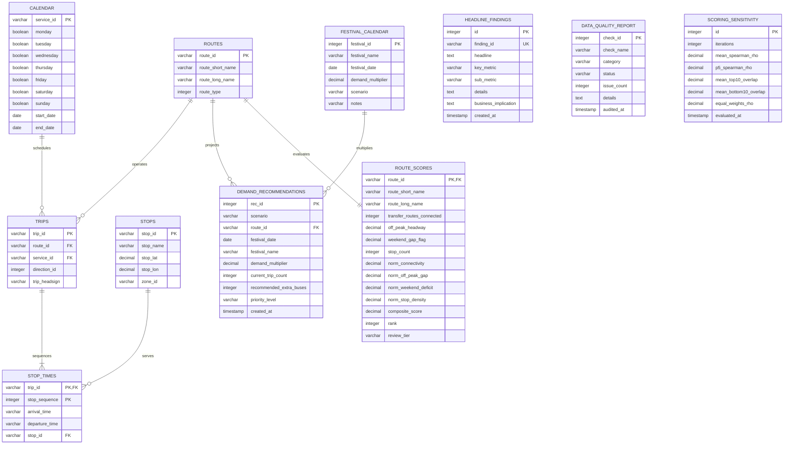

# Entity Relationship Diagram (ERD) & Data Schema

The platform maintains a relational PostgreSQL schema partitioned into **GTFS Core Entities**, **Analytical Demand Models**, and **Auditing & Decision Support Tables**.

---

## Relational Architecture Diagram

---

## Schema Component Descriptions

### 1. GTFS Ingestion Core
- **`routes`**: Bus line identifiers, short line numbers, and descriptive terminal-to-terminal names.
- **`stops`**: Physical boarding points with geographic GPS latitude and longitude coordinates.
- **`calendar`**: Day-of-week boolean availability masks (`monday`...`sunday`) and date ranges.
- **`trips`**: Individual vehicle runs linked to routes and service schedules.
- **`stop_times`**: Chronological arrival and departure times at each stop sequence along a trip. Timestamps stored as `VARCHAR(20)` to natively support GTFS overnight schedules ($\ge \text{24:00:00}$).

### 2. Analytical Decision Support
- **`festival_calendar`**: Evaluates 15 Indian cultural and regional events across Low, Base, and High scenario multipliers.
- **`demand_recommendations`**: Pre-computed corridor extra vehicle requirements across all festivals and scenarios.
- **`route_scores`**: Multi-criteria Route Prioritization Index (RSGPI) synthesizing normalized transfer connectivity, off-peak headways, weekend availability, and stop counts.
- **`scoring_sensitivity`**: Audit log of 500-iteration Monte Carlo sensitivity analysis measuring Spearman rank correlation and Top-10 stability.
- **`headline_findings`**: Auto-populated quantified executive consulting metrics.
- **`data_quality_report`**: Feed verification log recording nulls, orphans, duplicate records, and spatial validity.
